# Sitio Fatima Restaurant: Food Ordering and Preparation Queue System

A menu-driven Java console application for recording, organizing, and preparing customer orders at Sitio Fatima Restaurant.

---

## Project Description

In a small restaurant, orders are often taken faster than the kitchen can cook them. Without a system, orders can be forgotten, prepared out of turn, or hard to find when a customer asks about them. Customers who ordered first may end up waiting the longest, and staff have no quick way to look up or organize the day's orders.

This application addresses those problems. Each order is recorded with a customer name, the items ordered, and a computed total. Every new order automatically joins a **preparation queue**, so the kitchen always cooks orders in the order they were received (first-in, first-out). Staff can also search for an order, sort the order records by different fields, and view pending and completed orders separately.

The program uses only the `main` method and static methods, with no custom classes or other OOP techniques. Data is stored in multiple synchronized `ArrayList`s, and a Java `Queue` handles the kitchen workflow.

---

## Objectives

- To record customer orders (name, items, quantities, and total amount) using Java `ArrayList`s.
- To serve orders fairly using a first-in, first-out (FIFO) preparation queue built with `Queue` and `LinkedList`.
- To organize order records using manually implemented sorting algorithms (Bubble Sort, Insertion Sort, and Selection Sort) without built-in sorting methods.
- To allow staff to quickly find orders by order number or customer name.
- To separate pending and completed orders so the status of the kitchen is always clear.
- To keep all related data synchronized across multiple `ArrayList`s.
- To handle invalid inputs and empty states without the program crashing.

---

## Use Cases and Features

### Main Menu Options

| Option | Function | Description |
|---|---|---|
| 1 | Take a new order | Enter the customer name, choose items from the menu, and enter quantities. The total is computed automatically and the order is added to the kitchen queue (enqueue). |
| 2 | Display orders | View all orders, only pending orders, or only completed orders. |
| 3 | Search for an order | Search by order number, or by customer name (partial and case-insensitive matches work). |
| 4 | Sort orders | Choose a sorting algorithm and a direction (ascending or descending). Records are shown before and after sorting. |
| 5 | Kitchen queue | Prepare the next order (dequeue), peek at the next order, display the current queue, or check whether the queue is empty. |
| 6 | Update a customer name | Correct the name on an existing order. |
| 7 | Remove / cancel an order | Delete an order after confirmation. A cancelled pending order is also removed from the queue. |
| 8 | About the sorting algorithms | Displays an explanation of each sorting algorithm and why it was chosen. |
| 0 | Exit | Closes the program properly. |

### Restaurant Menu

| Item | Price (PHP) |
|---|---|
| Chicken Adobo with Rice | 85.00 |
| Pork Sinigang | 95.00 |
| Pancit Canton | 70.00 |
| Lumpia (5 pcs) | 50.00 |
| Fried Chicken with Rice | 90.00 |
| Halo-Halo | 60.00 |
| Iced Tea | 30.00 |
| Bottled Water | 20.00 |

### Key Features

- **Sample orders on startup:** four sample orders (#1001 to #1004) are loaded so the features can be demonstrated immediately.
- **Automatic order numbers:** order numbers start at 1001 and increase with each new order.
- **Pending and completed tracking:** each order has a status of `Pending` or `Completed`.
- **Input validation:** invalid menu choices, letters typed where numbers are expected, and empty names are rejected with a clear message. The program keeps asking until valid input is given.
- **Helpful messages:** the program displays messages for empty record lists, an empty queue, missing records, and cancelled operations.

---

## Data Structure Explanation

### ArrayLists (Record Storage)

Because the project does not use custom classes, each order record is stored across **five parallel `ArrayList`s**:

| ArrayList | Stores |
|---|---|
| `ArrayList<Integer> orderNumbers` | The unique order number |
| `ArrayList<String> customerNames` | The customer's name |
| `ArrayList<String> orderDetails` | The items ordered, for example `2x Halo-Halo, 1x Iced Tea` |
| `ArrayList<Double> totalAmounts` | The total price of the order |
| `ArrayList<String> statuses` | `Pending` or `Completed` |

**The value at index `i` in every list belongs to the same order.** For example, if `orderNumbers.get(2)` is 1003, then `customerNames.get(2)`, `orderDetails.get(2)`, `totalAmounts.get(2)`, and `statuses.get(2)` all describe order 1003.

To keep the lists synchronized, all changes go through three helper methods:

- `addRecord(...)` adds one value to each of the five lists at the same time.
- `removeRecordAt(index)` removes the same index from all five lists.
- `swapRecords(i, j)` swaps the values at two positions in all five lists. Every sorting algorithm uses this method, so a record's fields are never separated during sorting.

The program also uses `findIndexByOrderNumber(...)`, a linear search that finds the position of an order from its order number.

### Queue (Kitchen Preparation Line)

The kitchen line is a `Queue<Integer> prepQueue = new LinkedList<>()` that stores **order numbers**.

- **Enqueue (`add`):** when a new order is taken, its order number is added to the back of the queue.
- **Dequeue (`poll`):** when the kitchen prepares the next order, the order number at the front is removed. The matching record's status changes from `Pending` to `Completed`.
- **Peek (`peek`):** shows the next order to be prepared without removing it.
- **Display:** shows every waiting order from the front to the back, with its place in line.
- **Is empty (`isEmpty`):** checks whether any orders are waiting.

**FIFO principle:** the first order added to the queue is always the first one prepared.

**Why the queue stores order numbers instead of list positions:** sorting changes the positions of records in the `ArrayList`s. Because the queue holds order numbers, which never change, sorting the records does not disturb the kitchen's first-come, first-served order. After dequeuing, the program uses `findIndexByOrderNumber(...)` to locate the correct record.

**The queue is part of the main workflow:** taking an order enqueues it, preparing an order dequeues it and updates its record, and cancelling a pending order removes it from the queue as well.

---

## Sorting Algorithm Explanation

All sorting algorithms are written manually. No built-in sorting methods (such as `Collections.sort` or `Arrays.sort`) are used. Each algorithm can sort in **ascending or descending** order, and the program displays the records **before and after** sorting along with the number of swaps performed. All three use the `swapRecords(...)` method so that all five `ArrayList`s stay synchronized.

### 1. Bubble Sort: sorts by Order Number

**How it works:** repeatedly compares neighboring records and swaps them if they are in the wrong order. After each pass, the largest remaining value "bubbles" to its final position. If a full pass makes no swaps, the sort stops early.

**Why it is suitable:** orders are created with increasing numbers, so the list is usually almost sorted already. Bubble Sort stops early on nearly sorted data, which makes it efficient for this case, and it is easy to trace and understand.

### 2. Insertion Sort: sorts by Customer Name

**How it works:** takes each record in turn and slides it left until it sits in the correct place among the records before it, like arranging playing cards in your hand. Names are compared without regard to uppercase or lowercase.

**Why it is suitable:** a small restaurant has a small list that grows one order at a time, and Insertion Sort performs well on small lists. It is also stable, so orders with the same customer name stay in the order they were taken.

### 3. Selection Sort: sorts by Total Amount

**How it works:** for each position, it finds the smallest (or largest) remaining value in the unsorted part of the list and swaps it into place.

**Why it is suitable:** Selection Sort makes at most *n − 1* swaps. Since every swap moves data in five `ArrayList`s, fewer swaps means less work. It is useful for finding the largest or smallest orders of the day.

### Summary

| Algorithm | Sorts by | Best case | Worst case | Notable strength |
|---|---|---|---|---|
| Bubble Sort | Order number | O(n) with early exit | O(n²) | Fast on nearly sorted data |
| Insertion Sort | Customer name | O(n) | O(n²) | Good for small lists; stable |
| Selection Sort | Total amount | O(n²) | O(n²) | Fewest swaps |

---

## How to Run the Program

### Requirements

- Java Development Kit (JDK) 11 or newer installed.
- A terminal (Command Prompt, PowerShell, or the VS Code terminal).

To check that Java is installed, run:

```
javac -version
```

### Steps

1. Open a terminal in the **project's main folder** (the folder that contains the `src` folder).

2. Compile the program. The compiled files go into the `bin` folder:

   ```
   javac -d bin src/SitioFatimaRestaurant.java
   ```

3. Run the program:

   ```
   java -cp bin SitioFatimaRestaurant
   ```

4. The main menu appears. Type the number of an option and press **Enter**. Choose `0` to exit.

**Running in VS Code:** with the Extension Pack for Java installed, you can also open `SitioFatimaRestaurant.java` and click **Run** above the `main` method.

---

## Screenshots of the System

All screenshots were taken from the actual running application.

### 1. Main Menu

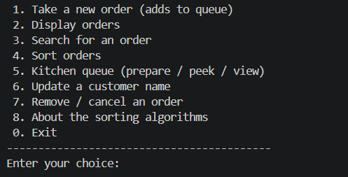

*The main menu showing all available options.*

### 2. Adding Records

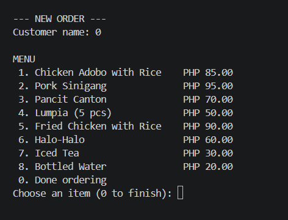

*Taking a new order: entering the customer name, selecting menu items and quantities, and the order being recorded and added to the queue.*

### 3. Displaying Stored Records

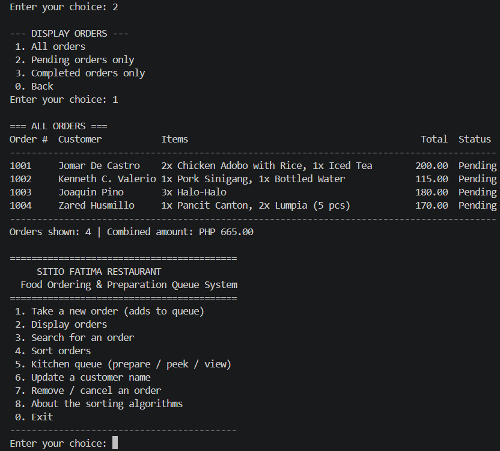

*Displaying all stored order records with their order numbers, customers, items, totals, and statuses.*

### 4. Pending and Completed Orders

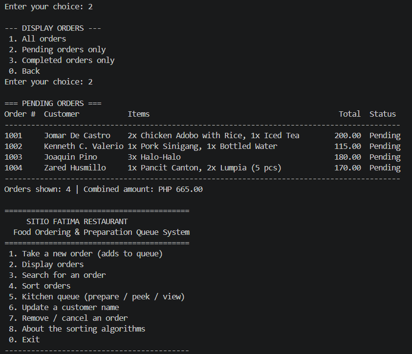

*Displaying pending orders only.*

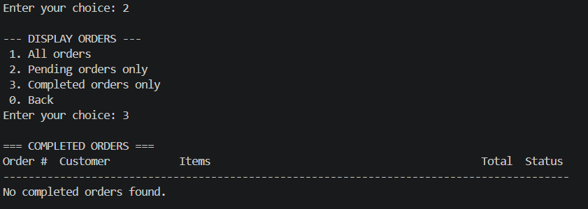

*Displaying completed orders only, after some orders have been prepared.*

### 5. Queue Operations

**Enqueue**

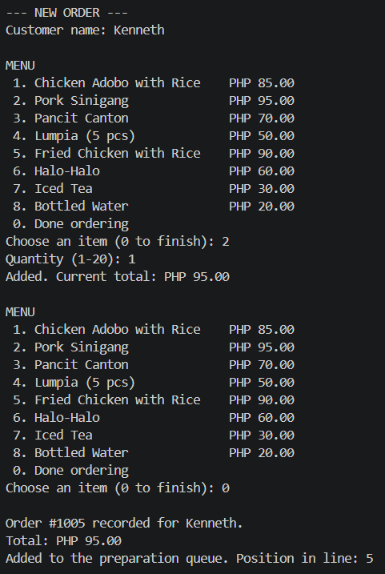

*Enqueue: a new order is added to the back of the queue, and its position in line is shown.*

**Peek**

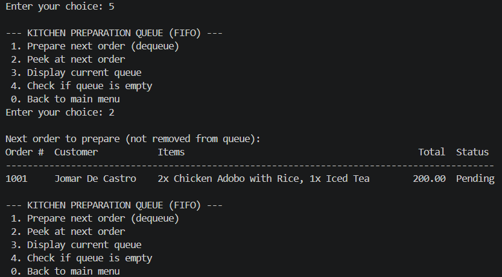

*Peek: shows the next order to be prepared without removing it from the queue.*

**Display queue**

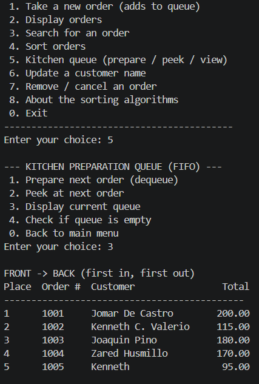

*Displaying the current queue from front to back.*

**Dequeue**

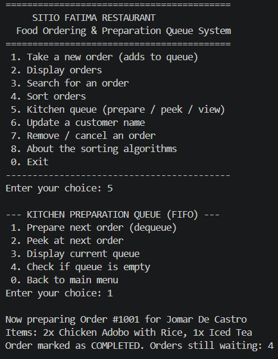

*Dequeue: the next order is prepared and its status becomes Completed.*

**Empty queue message**

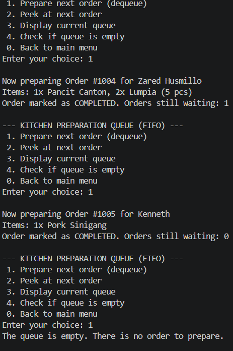

*The message shown when the queue is empty and no order can be prepared.*

### 6. FIFO Behavior

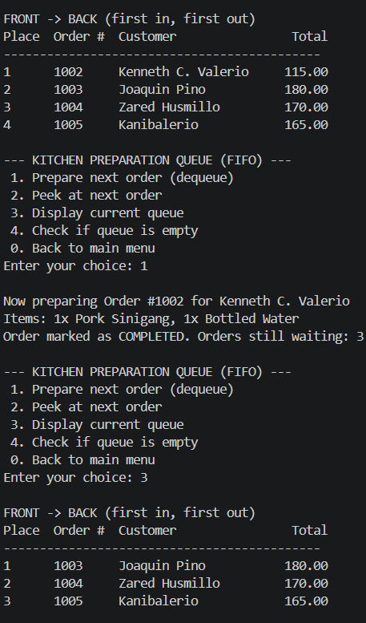

*FIFO demonstration: the queue is displayed in the order the orders were added, and the orders are then prepared one by one. The first order added is the first order processed.*

### 7. First Sorting Algorithm: Bubble Sort (by Order Number)

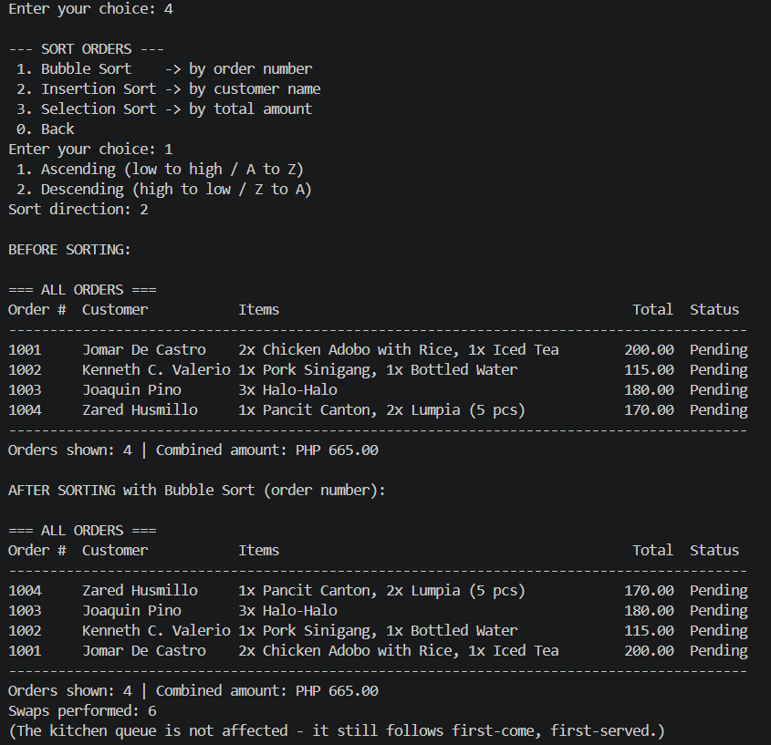

*Bubble Sort: the records before sorting and after sorting by order number, with the swap count.*

### 8. Second Sorting Algorithm: Insertion Sort (by Customer Name)

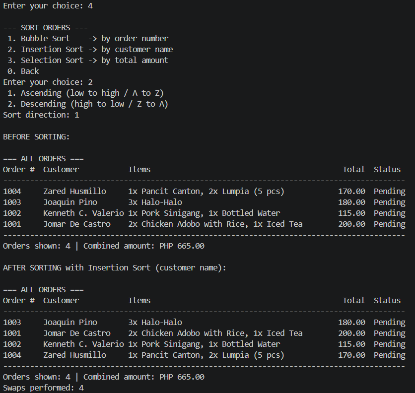

*Insertion Sort: the records before sorting and after sorting by customer name.*

### 9. Additional Sorting Algorithm: Selection Sort (by Total Amount)

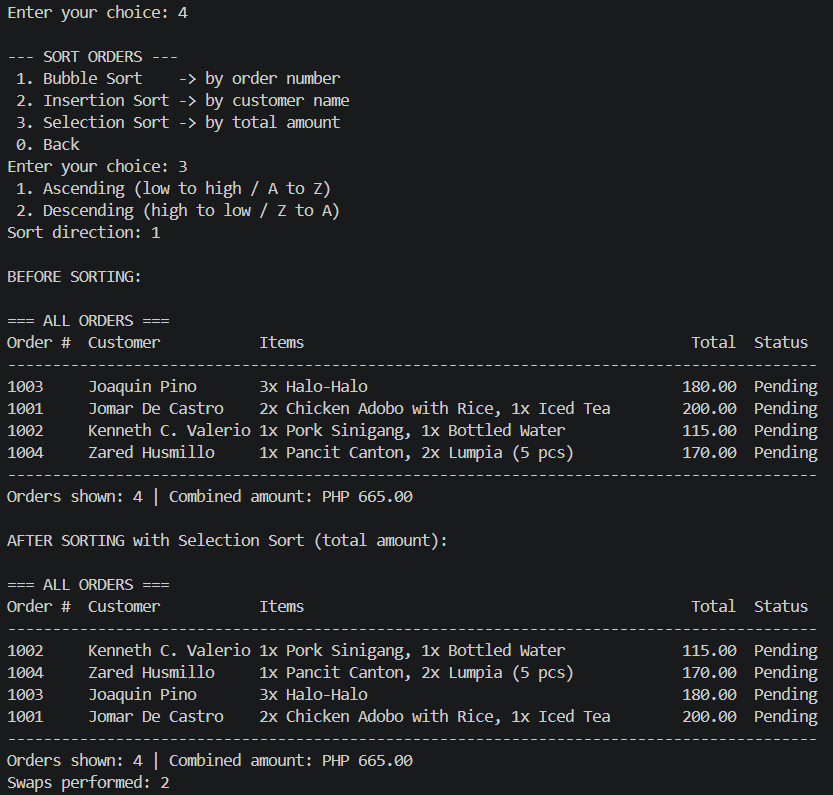

*Selection Sort: the records before sorting and after sorting by total amount.*

### 10. Search

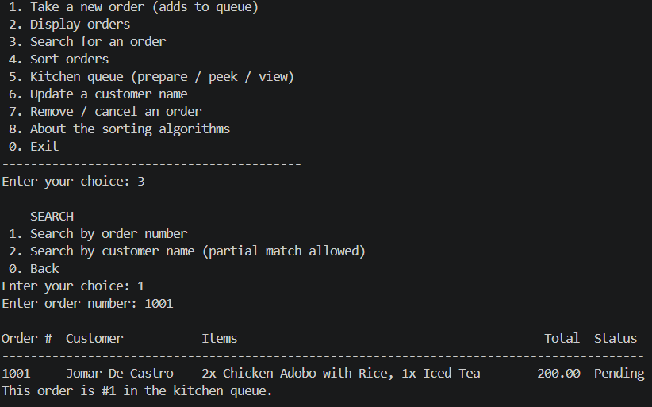

*Searching for an order by order number.*

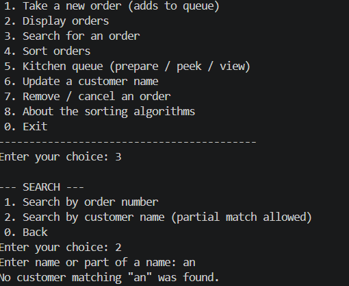

*Searching for orders by customer name.*

### 11. Input Validation and Error Messages

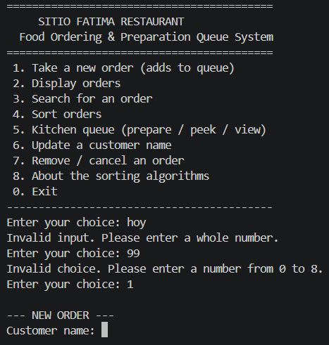

*Invalid menu choices, letters typed instead of numbers, and other invalid inputs are rejected with clear messages, and the program asks again instead of crashing.*

### 12. Exiting the Program

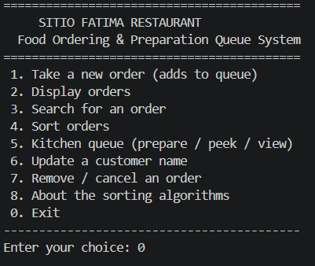

*Choosing option 0 closes the program properly.*

---

## Project Structure

```
SitioFatimaRestaurant/
├── src/
│   └── SitioFatimaRestaurant.java
├── bin/
├── screenshots/
│   ├── 01-main-menu.png
│   └── ...
└── README.md
```

---

## Programming Approach

This project follows a **procedural programming** approach, as required:

- Only the `main` method and static methods are used.
- No custom classes, objects, inheritance, polymorphism, encapsulation, or abstraction are used to model records or application logic.
- Records are stored in multiple `ArrayList`s with consistent indexes.
- Sorting algorithms and the queue are implemented with methods and Java built-in collections, not custom classes.